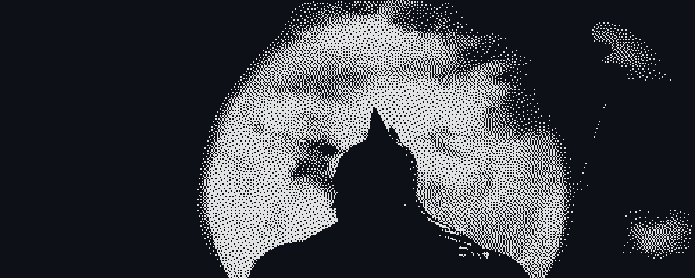
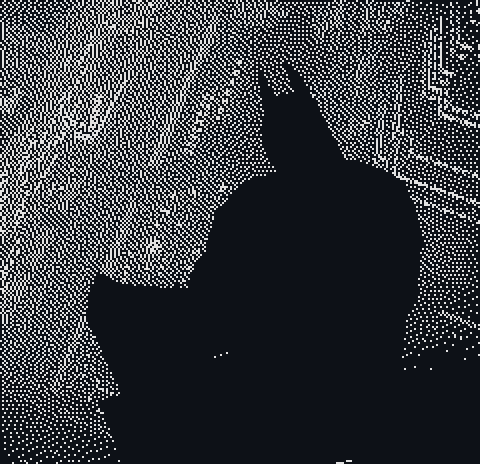
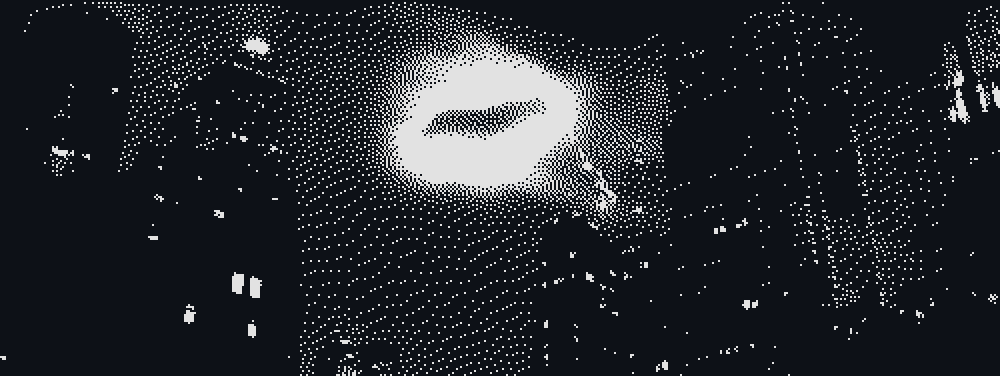

  

<h1 align="center">BabyCreed</h1>

  

Mobile developer · South Africa · Building healthcare tech in the shadows

<h2 align="center">The Watcher</h2>

<table>
  <tr>
    <td width="55%" valign="top">
      
I build mobile apps with <b>Flutter</b> and back them with <b>Supabase</b>. Clean architecture, quiet interfaces, and code that holds up at 2&nbsp;a.m.

      
Right now I'm working on <b>CliQ</b>, a queue platform for South African private clinics, so patients can wait from anywhere instead of a crowded waiting room.

      
Also building <b>Loopd</b>, a Flutter app shipped one phase at a time.

      
<i>Ship quietly. Let the product speak.</i>

    </td>
    <td width="45%" align="center">
      
    </td>
  </tr>
</table>

<h2 align="center">Arsenal</h2>

  

<h2 align="center">Night Patrol</h2>

  
  

  

<h2 align="center">Signal</h2>

  
  <!-- Add contact links here, e.g.:
  
  
  -->

  

<i>"It's not who I am underneath, but what I commit that defines me."</i>

