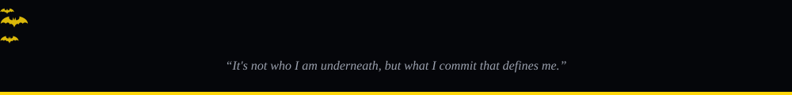

<p align="center">
  
</p>

<p align="center">
  <a href="https://github.com/BabyCreed">
    
  </a>
</p>

<p align="center">
  
  
</p>


## 🦇 &nbsp;Case File

```dart
final babyCreed = Vigilante(
  alias:     'BabyCreed',
  base:      'South Africa 🇿🇦',
  patrol:    ['Flutter', 'Dart', 'Supabase', 'PostgreSQL'],
  mission:   'Ending the waiting-room queue in private clinics',
  utilityBelt: ['clean architecture', 'pixel-perfect UI', 'late-night commits'],
  motto:     'Ship quietly. Let the product speak.',
);
```


## 🛠️ &nbsp;Utility Belt

<p align="center">
  
  
  
  
  
  
  
  
</p>


## 🏙️ &nbsp;Currently Protecting

| Project | Mission | Stack |
|:--|:--|:--|
| **CliQ** | Smart queue platform for SA private clinics — patients wait from anywhere, not the waiting room | Flutter · Supabase |
| **Loopd** | Mobile companion app, built in phases | Flutter · Dart |


## 📡 &nbsp;Batcomputer Readout

<p align="center">
  
  
</p>

<p align="center">
  
</p>


## 📟 &nbsp;Signal Me

<p align="center">
  <!-- Add contact links here, e.g.:
  <a href="mailto:you@example.com"></a>
  <a href="https://linkedin.com/in/you"></a>
  -->
  <a href="https://github.com/BabyCreed"></a>
</p>

<p align="center">
  
</p>
